# 珠宝清洗剂 电商推广首单 · 全流程执行审计报告（第 1 轮）

| 项 | 值 |
|---|---|
| runId | `20261113-152948-jewelry-clean` |
| DSH 会话 | `session-e9fd5f88-fb05-4c8f-9a1f-e966060ac76f` |
| 账户 | `main`（baidu-YF电商-玛卡快消01，sub `bfb7bb5c-2c51-4b0e-8872-09b62b63dd80`） |
| 业务时间窗 | 2026-11-13 15:29:24 → 16:11:44（北京时间，周五，高峰时段） |
| 最终状态 | `success-paused`：计划 `2387079078` 建成并暂停（pause=true / status=2），**未开量** |
| 线上对象 | imageId `24468661981`(750×1000 现役) / `24467907335`(800×800 作废留存)；packageId `1618363218409`(26 词)；campaignShoppingId `2387079078` |
| 结论摘要 | 链路首次跑通；**建计划 4 次、换图 4 版、审计 6 轮、pause 纠偏 2 次**；总耗 ¥5.5437（全高峰） |

> 本报告的数据来源：run 目录全部产物（`manifest.json`、`07-audit/audit-report.md`、`06-payloads/*`、`08-execution/*`）、DSH 会话归档（`~/.dsh/sessions/.../session.v4.jsonl.zstd` 的 `usage`/`tool` 事件）、百度 MCP 调用审计（`query_audit`，call_id 可复核）。所有金额按 DeepSeek 官方 2026 价目表计算。

---

## 1. 遇到的问题（完整清单，按严重度分级）

分级口径：**P0** 会导致链路失败/资损或结论错误；**P1** 造成返工与额外成本；**P2** 记录瑕疵/口径不一致。

### 1.1 P0 · 业务阻塞级

| # | 问题 | 现象/证据 | 根因 | 代价 |
|---|---|---|---|---|
| P0-1 | `addCampaignShopping` 对 `material` 的**品牌头像 `userPortrait` 实际必带**，schema/文档未体现 | 第 1 次建单 `901217 物料错误：创意设置品牌头像错误`（call `f544250ba6ae`，15:50:12，req 2521B） | schema 对 `material` **没有任何 `required`**（不是「只标 brand/title」）；文档只把 userPortrait 列为"素材组成之一"，未标必填；我方按 schema 拼参数 | 1 次失败重试 + 1 轮审计（第三轮）+ 1 版 payload |
| P0-2 | `pictures` 只接受官方三档尺寸（商品推广 **370×245 / 1140×640 / 750×1000**，自定义直播推广仅 1140×640），`uploadImage` 不做尺寸校验；实测仅覆盖 750×1000 通过 / 800×800 被拒，未逐档穷举 | 第 2 次建单 `901217 物料错误：创意设置图片ID对应图片不存在或尺寸不合规`（call `63eabbdd872f`，15:54:24）；上传得到的 `24467907335` 是 800×800 | 上游选图（`getProduct.logo` 800×800）时未核对创意尺寸约束，"上传成功"被当成"可用" | 1 次失败重试 + 2 张废图 + 2 轮成员4/6 + 1 轮审计 |
| P0-3 | `audience` 当时按「14 键全带」推断，实际**只有 `interests` 必带**（缺则 `901216`），空对象报 `901214`，其余键可省且服务端补默认值 | 第 3 次建单 `901216 兴趣错误`（call `f305708a13aa`，16:04:28）；当时 audience 仅 7 键，缺 `interests` 等 | 定向参数按「最小可用集」设计，漏了必带的 `interests`；事后误推广成「缺键即拒 / 不补默认」（已复核推翻） | 1 次失败重试 + 1 版 payload（v7）+ 1 轮审计 |
| P0-4 | **`uploadImage` 成功 ≠ 图片可投放**：该接口只入库，不校验尺寸也不校验内容 | `img-001` 带「豆包AI生成」水印 + 「净含量：0mL」AI 错字 + 「不伤表面」绝对化；`img-003`（复用图库既有图，尺寸合规）仍带 AI 水印 + 使用前后对比 + 「污渍自动溶解」 | 素材准入没有把"水印/前后对比/绝对化"做成硬闸；审计第四轮才目视发现 | 2 轮成员4 返工 + 2 轮审计 + 图库留 2 张废图 |
| P0-5 | **`addCampaignShopping` 的 `pause` 参数不生效**：创建回显 `pause=true`，实际落库 `pause=false`、`status=20`（与绑包无关） | ⑧-4 创建返回 `pause=true`；⑧-5 `bindPlanKeywordPackages`（`ed683f821613`）后回读 `pause=false / status=20 审核中` | 创建接口忽略 `pause`（后端建单即进审核流程）；此前误判为「绑包触发」，已用不绑包的对照实验推翻 | 1 次额外 `updateCampaignShopping` 往返 + 额外审计判断；若不回读会"以为暂停、其实已进审核" |
| P0-6 | 暂停纠偏的**全量读-改-写请求被拒** `901202 创意类型错误` | call `b48e7a57b79c`（16:10:17，req 2240B，含 `material`+`audience`14键+`pause`） | update 带 `material` 时**必须同时给 plan 级 `ideaType`**，漏传即报「创意类型错误」；与回写只读字段/位形标记无关（A/B 实测） | 1 次失败写调用（无副作用）+ 1 次最小请求体重试 |

### 1.2 P1 · 返工与成本级

| # | 问题 | 现象/证据 | 根因 | 代价 |
|---|---|---|---|---|
| P1-1 | 定向字段靠"惯例推测"填写（`regionType="1"` / `region="全国"`）；**`region` 非法值会被静默降级为「不限全国」** | 一审打回 M1；实测既有计划为 `regionType="0"` / `region="9999999"`（call `4388012c0e20`/`39932461b7b8`）。2026-11-14 复现：建单传 `region="全国"`（`regionType=1`）→ **建单成功不报错**，响应回显 `region=""`、读回 `region="9999999"`（不限），call `4c226c359a9f` / `44d40e5fe7b6` | 方案模板给的取值未标注"文档口径 vs 实测口径"；且该字段**静默失败**（不校验地域码，非法值按"不限"落库），写完不回读根本发现不了 | 1 轮审计打回 + ⑤ 出 v2；若误传中文地名而未回读，**地域定向会被放大到全国（资损级）** |
| P1-2 | `region="9999999"`（不限）的取值口径 | 既有计划读回是 367 段 ID 串（len=2133）；本轮 ⑧-6 回读确认为 `9999999`。**2026-11-14 已补实测**：不传 `region` 时服务端默认落 `9999999`，读回稳定（探针计划 2388220752 / 2392824411） | 早期只有文档口径，现在已是"文档 + 实测"双口径 | 无需额外代价（回读即可确认） |
| P1-3 | 上游记载与实图不符：`spec` 记「约 60mL」，图上实为「0mL」 | 一审 M3；`required-fields.v3` 更正为「AI 错字，规格待核实，禁止写入创意」 | 成员1 首版依据模糊字迹推测 | 1 轮返工（① 出 v3） |
| P1-4 | `fcKeywordWtpids` 占位符 `PENDING:packageId` 过不了 schema `^\d+(,\d+)*$` | ⑥ 首版直接删键，改为"⑧-5 绑包"；牵出"替换式语义"风险 | 占位符与 schema 冲突没有预置方案 | 设计变更 1 次 + 额外 G3 前置 |
| P1-5 | **manifest 指向的文件版本长期滞后于真实执行版** | 一审 R1：manifest 指向 `addCampaignShopping.json`(v1)；`execution-plan` 的 ⑧-4 `input` 依次滞后 v2→v3→v6，审计每次都要出 R2/R2′ 更正 | 版本号没有与文件名强绑定；`version` 字段与 `.vN` 文件错位（`04-assets.version=7` 而文件是 `image-map.v6.json`） | 每轮审计多一项核对；**若非人工纠正，会拿旧 payload 再撞同一错误、白烧"最后一次"重试额度** |
| P1-6 | 机检脚本 `validate_payloads.py` **读死 `04-assets/image-map.json`（v1）** | 跑法 A 恒 FAIL（把真实 imageId 判"编造"）；只能"临时目录把 vN 就位"跑法 B 才 PASS | `load_image_map()` 硬编码路径，无 `--image-map`，不按 supersedes 链取最新 | 每轮审计/预检都要人工兜底 + 额外验证跑法（6 轮） |
| P1-7 | 机检脚本 `check_image_ids()` 把 `userPortrait.imageId` 当素材图去映射表查 | 跑法 A 第二条 FAIL：`15505964077` 判编造 | 未区分"素材图溯源"与"复用已过审品牌头像"两类来源 | 假告警，需人工解释 |
| P1-8 | **schema 与实测冲突**：`audience.excludeTrans` enum 只有 `["1","4"]`，服务端实测接受 `"0"` | 审计实跑反证：v7 + `"0"` → INVALID；既有计划实测均为 `"0"` | schema 是我方自造认知；冲突时被逼"payload 迁就 schema" | v7 少传 1 键，改由服务端默认（回读证实落 `"0"`）；`snapshot_diff` 也会把真值判非法 |
| P1-9 | `backfill_image_ids.py` 自动回填失败 | ⑧-2 只能手工回填（读死 v1 + 期望响应带 imageName） | 同上脚本局限 | 人工操作 2 次 |
| P1-10 | ⑧-2 需**重复上传**：img-002 上传后才发现尺寸不合规 | `f516458c9413`(800×800 作废) → `ee26d603cf48`(750×1000) | 选图前置校验缺失（先上传再发现不能用） | 1 次无效写调用 + 1 张废图 |
| P1-11 | `updateCampaignShopping` 不在本轮授权范围，但建单后 `pause` 是 false（建单忽略该参数）→ 需临时授权链 | 成员8 停手 → 团长决定"按用户原始指令 pause=true 纠正" → 成功（`ff4c9eaccc78`） | 授权模型按"步骤"授权，未覆盖"建单语义缺陷的补救" | 1 次额外协商 + 2 次写调用 |
| P1-12 | 存在**遗留孤儿 run**：`20261113-152452-jewelry-clean` | 该 run 15:24:52 创建，仅产出 `02-keywords/packages.json`、`03-copy/*`，`finalStatus` 仍是 `running`，从未收尾；15:25–15:26 的 9 次 MCP 只读调用属于它 | 上一轮尝试中断后直接新建 run，未标记旧 run 作废 | 重复作业约 1 分钟 + 9 次调用；审计时产生"这批调用归属不明"的噪音 |

### 1.3 P2 · 记录与口径瑕疵

| # | 问题 | 说明 |
|---|---|---|
| P2-1 | ⑤v2 的 `material.pictures[0].imageId` 残留 `PENDING:img-001`，⑥ 已改为 `PENDING:img-002.png` | 上下游占位符不一致，需靠 `_notes.deviations` 声明 |
| P2-2 | `required-fields.v3` 内部自相矛盾 | `userConfirmations.unchangedFields` 仍含 `spec`；`complianceNotesRetained` 仍写「60mL 需实物核对」 |
| P2-3 | ⑥ 曾**原地同名重写**已被审计消费的 payload | 违反"冻结不改写"，虽在 `_notes.revisionReason` 说明且 diff 可复核 |
| P2-4 | `03-copy/image-prompts.md#img-001` 提示词块**无对应产出** | 最终素材改取 `getProduct.logo`，`promptRef: null`，编号-文件-映射三方对应断裂 |
| P2-5 | 成员6 声明 `auditStatus=2（机审通过）`，审计当时无法复现 | 原因是用 `fields` 把 `auditStatus` 过滤掉了；**不传 `fields` 即可复现**（`15505964077` → `auditStatus: 2`、`reason: "已通过搜索推广机审策略"`，call `5ae713fd6b9b`） |
| P2-6 | 口径反复更正 | audience"12 键 vs 14 键"、"v7 是 11 键还是 12 键"在审计与成员间来回纠正 3 次 |
| P2-7 | run 目录文件命名超出协议封闭清单 | 各目录出现 `image-map.v2..v6.json`、`required-fields.v2/v3.json`、`plan-draft.v2.json`、`addCampaignShopping.v2..v7.json`、`_*-response.json`（下划线前缀合法，`.vN` 合法，但 `version` 与文件名脱钩） |
| P2-8 | 6 次 `uploadImage` 被 readonly 端点拒绝（`denied`，request_bytes=2、response_bytes=0） | 时间 14:26–14:45，**早于本 run 创建**，属更早会话的越权尝试；本 run 未复现 |

### 1.4 问题分布小结

| 层 | P0 | P1 | P2 |
|---|---:|---:|---:|
| 百度接口业务语义（schema vs 实测） | 3（P0-1/2/3） | 2（P1-1/8） | — |
| 素材/图片链路 | 1（P0-4） | 2（P1-9/10） | 2（P2-4/5） |
| 写操作语义（含建单忽略 `pause`） | 2（P0-5/6） | 1（P1-11） | — |
| 版本/状态机/契约 | — | 2（P1-5/12） | 5（P2-1/2/3/7 + P2-6） |
| 工具/脚本 | — | 2（P1-6/7） | 1（P2-5） |
| 内容与文案 | — | 1（P1-3） | — |

---

## 2. 运行时长、模型调用次数与 Token/人民币成本

### 2.1 运行时长

| 口径 | 值 |
|---|---|
| 墙钟总时长（用户 brief → 最后一次模型输出） | **42 分 20 秒**（15:29:24 → 16:11:44） |
| 建 run 时刻 | 15:29:48（`manifest.createdAt`） |
| 首次 MCP 调用 | 15:30:19（`getProduct` `209e42fc84d6`） |
| 末次 MCP 调用 | 16:11:35（`getCampaignShopping` `5c8ac37c3ce3`） |
| MCP 侧净耗时 | 54 次调用，单次 0.26–2.22 s，累计约 46 s（接口本身不是瓶颈） |
| 串行瓶颈 | 审计 6 轮 + 建单 4 次 + 换图 4 版；团长 `wait_agent` 等子 agent 共 50 次 |

**阶段并行/串行**：①–④ 并行发起（②③ 15:31:43 同时起，① 15:30:07，④ 15:34:05）；⑤–⑧ 严格串行，且每次失败都要"回成员6 改 payload → 审计定向复审 → 回成员8 重试"三段往返。

### 2.2 模型调用与 Token（按会话细分）

模型：`deepseek-v4.1-flash`（= DeepSeek-V4.1-Flash-1017），12 个会话，**438 次模型调用**。

| 阶段 | 会话 | 起—止 | 调用 | 输入未命中 | 输入命中(缓存) | 输出 | 合计 tokens | 高峰费用 |
|---|---|---|---:|---:|---:|---:|---:|---:|
| 编排 | 团长 lead | 15:29:26–16:11:44 | 78 | 117,537 | 6,844,800 | 46,255 | 7,008,592 | ¥0.8789 |
| ① 商品 | m1-product | 15:30:07–15:40:32 | 23 | 44,462 | 867,200 | 15,902 | 927,564 | ¥0.2508 |
| ② 词包 | m2-keywords | 15:31:43–15:33:39 | 17 | 80,053 | 823,424 | 17,943 | 921,420 | ¥0.3366 |
| ③ 文案 | m3-copy | 15:31:43–15:32:15 | 6 | 12,384 | 88,064 | 4,708 | 105,156 | ¥0.0660 |
| ④ 素材（4 版） | m4-assets ×4 | 15:34:05–16:00:43 | 58 | 59,027 | 951,680 | 23,653 | 1,034,360 | ¥0.3453 |
| ⑤ 计划 | m5-plan | 15:34:52–15:40:35 | 13 | 31,036 | 442,368 | 20,510 | 493,914 | ¥0.2438 |
| ⑥ 参数 | m6-payloads | 15:36:24–16:06:05 | 53 | 71,456 | 3,202,304 | 39,852 | 3,313,612 | ¥0.5898 |
| ⑦ 审计（6 轮） | m7-audit | 15:37:15–16:07:48 | 80 | 147,846 | 9,709,312 | 97,774 | 9,954,932 | ¥1.4663 |
| ⑧ 实施 | m8-exec | 15:46:45–16:11:26 | 110 | 136,136 | 11,568,768 | 78,888 | 11,783,792 | ¥1.3661 |
| **合计** | 12 | 15:29:26–16:11:44 | **438** | **699,937** | **34,497,920** | **345,485** | **35,543,342** | **¥5.5437** |

④ 素材 4 段的明细：`m4-assets`(首版 img-001) 10 次/198,635 tokens/¥0.0770；`m4-assets-2`(img-002) 17 次/282,498/¥0.0864；`m4-assets-3`(img-003) 12 次/209,481/¥0.0797；`m4-assets-4`(img-004) 19 次/343,746/¥0.1022。

### 2.3 计价规则与金额（DeepSeek 官方，元/百万 tokens）

| 计费项 | 空闲时段 | 高峰时段 |
|---|---:|---:|
| 输入·缓存命中 | 0.02 | 0.04 |
| 输入·缓存未命中 | 1 | 2 |
| 输出 | 4 | 8 |

高峰 = 北京时间 周一至周五（非法定节假日）09:00–12:00、14:00–18:00；其余（含周末/节假日全天）为空闲，价格为高峰一半。来源：[DeepSeek 模型&价格](https://api-docs.deepseek.com/zh-cn/quick_start/pricing)。

**本 run 全部 438 次调用落在 15:29–16:11（周五 14:00–18:00 高峰窗内）→ 空闲费用 ¥0，高峰费用 ¥5.5437。**

| 时段 | 输入未命中 | 输入命中 | 输出 | 费用 |
|---|---:|---:|---:|---:|
| 高峰 | 699,937 | 34,497,920 | 345,485 | **¥5.5437** |
| 空闲 | 0 | 0 | 0 | **¥0.0000** |
| 合计 | — | — | — | **¥5.5437** |

成本构成（高峰）：

| 项目 | 量 | 单价 | 费用 | 占比 |
|---|---:|---:|---:|---:|
| 输入·缓存未命中 | 699,937 | 2 元/M | ¥1.3999 | 25.3% |
| 输入·缓存命中 | 34,497,920 | 0.04 元/M | ¥1.3799 | 24.9% |
| 输出 | 345,485 | 8 元/M | ¥2.7639 | 49.9% |

参照：若同一批 token 全部落在空闲时段，费用为 **¥2.7719**（五折）。

### 2.4 成本归因（钱花在哪）

| 归因 | 费用 | 占比 | 说明 |
|---|---:|---:|---|
| 建单 ⑧-4 的 4 次尝试 + ⑧-5/⑧-6 回读 (m8) | ¥1.3661 | 24.6% | 110 次调用，最大单会话 |
| 6 轮审计 (m7) | ¥1.4663 | 26.4% | 输出 token 97,774，全场第二高 |
| 团长编排 (lead) | ¥0.8789 | 15.9% | 含 50 次 `wait_agent` 空转 |
| ⑥ 参数 7 版 payload (m6) | ¥0.5898 | 10.6% | 53 次调用，缓存读 3.2M |
| ① ② ③ ⑤ 正常生产 | ¥0.8972 | 16.2% | 四阶段合计 |
| ④ 素材 4 版 | ¥0.3453 | 6.2% | 换图 3 次返工 |

**结论：**
- ⑧ 实施 + ⑦ 审计 + ⑥ 参数 + ④ 素材四项合计 **¥3.7675（68.0%）**——这四项里沉淀了全部 4 次建单尝试、6 轮审计、7 版 payload、4 版素材。
- 若把编排侧（lead 的等待与纠偏，¥0.8789）一并计入"返工与复审成本"，则达 **¥4.6464（83.8%）**。
- 真正的"一次性正常生产"（①②③⑤）只有 **¥0.8972（16.2%）**。

**换算：每 1 元里约 0.84 元花在返工上。**

---

## 3. 流程与流转原因

### 3.1 总览流程图

```mermaid
flowchart TD
    U["用户 brief（15:29:24）<br/>商品=珠宝清洗剂 / 4 卖点 / test.jpg<br/>首单 1计划+1词包+1图 / pause=true"] --> R["团长 new_run.py 建 run<br/>15:29:48"]
    R --> S1["① 商品分析 m1<br/>getProduct 定位 productId"]
    R --> S2["② 词包 m2<br/>KR/PvSearch 拓词"]
    R --> S3["③ 文案 m3<br/>10 标题 / 5 描述"]
    S1 -->|"brand 缺失、transType 多值<br/>→ 必须人工决策"| Q1{{"人工问答 #1<br/>15:31 提问 → 15:33 答"}}
    Q1 --> S1
    S2 --> S4["④ 素材 m4<br/>img-001（test.jpg 转码）"]
    S3 --> S4
    S1 --> S5["⑤ 计划 m5"]
    S2 --> S5
    S4 --> S5
    S5 --> S6["⑥ 参数 m6"]
    S6 --> S7["⑦ 审计 m7"]
    S7 -->|"一审打回：region 取值不可用 /<br/>img-001 有水印+0mL 错字+绝对化 /<br/>spec 60mL 与实图矛盾 /<br/>fcKeywordWtpids 删键无说明"| FIX1["返工：①v2→v3 / ④换图 / ⑤v2 / ⑥重写"]
    FIX1 --> S7b["⑦ 二审：通过<br/>放行 ⑧-1…⑧-5"]
    S7b --> S8["⑧ 实施 m8（唯一写入口）"]
    S8 --> E1["⑧-1 预检<br/>授权 + 读既有计划做基线"]
    E1 --> E2a["⑧-2 上传 img-002<br/>→ imageId 24467907335"]
    E2a --> E3["⑧-3 建词包<br/>→ packageId 1618363218409"]
    E3 --> E4a["⑧-4 建计划 #1"]
    E4a -->|"901217 缺品牌头像 userPortrait"| FIX2["⑥v3 + ⑦第三轮定向复审"]
    FIX2 --> E4b["⑧-4 #2"]
    E4b -->|"901217 图片 800×800 尺寸不合规"| FIX3["④img-003(750×1000) → ⑥v4"]
    FIX3 --> AUD4["⑦第四轮：img-003 内容不合规<br/>（AI 水印/前后对比/绝对化）→ 打回"]
    AUD4 --> FIX4["④img-004（官方主图版式适配 750×1000）"]
    FIX4 --> E2b["⑧-2 重新上传 img-004<br/>→ imageId 24468661981"]
    E2b --> E4c["⑧-4 #3 (v6)"]
    E4c -->|"901216 audience 缺 interests 等键"| FIX5["⑥v7：补齐 audience 键<br/>（其中仅 interests 必带）"]
    FIX5 --> AUD6["⑦第六轮定向复审：放行最后一次"]
    AUD6 --> E4d["⑧-4 #4 (v7)<br/>成功 → 2387079078"]
    E4d --> E5["⑧-5 绑包（替换式）<br/>绑前/绑后各读旧计划确认未变"]
    E5 -->|"pause 早在建单时即为 false（与绑包无关）"| E6["⑧-6 回读：pause 与 audience 键集合均与请求不同"]
    E6 -->|"用户原始指令 pause=true<br/>→ 授权纠正"| FIX6["updateCampaignShopping<br/>全量请求 901202 失败"]
    FIX6 --> FIX7["最小请求体 {id,pause:true}<br/>成功 → 暂停恢复"]
    FIX7 --> DONE["交付：pause=true / status=2<br/>未开量"]
```

### 3.2 关键流转原因（为什么这样走）

| 流转 | 触发原因 | 性质 |
|---|---|---|
| ①→人工问答#1 | `brand` 接口无、用户未给；读计划时 `brand` 是 `material` 的开关（写侧未验证）；`transType` 有 4 个可选值需业务决策 | **阻塞型人工闸**（设计合理） |
| ②③ 并行于 ① | 词包与文案互不依赖，只有 ⑤ 才需要三者齐备 | 拓扑并行（正确） |
| ④→人工问答#2 | 审计一审判 img-001 不可投放；但"重制合规图"在本链路不可执行（无文生图能力），必须用户选图 | **能力边界型人工闸**（合理） |
| ⑦ 一审打回 | 4 项问题（region 取值、图片、spec、删键说明） | 质量门禁（应更早拦截） |
| ⑧-4 #1→#2 | 901217 品牌头像 | 接口语义未知（schema 陷阱） |
| ⑧-4 #2→#3 | 901217 图片尺寸 | 素材准入缺失（上传≠可用） |
| ⑧-4 #3→④返工 | 审计第四轮判 img-003 内容不合规 | 内容合规闸（发现太晚） |
| ⑧-4 #3→#4 | 901216 定向缺键 | 只有 `interests` 必带，其余键服务端补默认 |
| ⑧-5→⑧-6 偏离 | 建单时 `pause` 即被忽略（与绑包无关） | 建单语义（必须回读才能发现） |
| ⑧-6→pause 修复 | 用户指令要求 pause=true，需纠正 | 授权外的必要补救 |

### 3.3 阶段时间线（Gantt）

```mermaid
gantt
    title 珠宝清洗剂 run 20261113-152948 时间线（北京时间 2026-11-13）
    dateFormat HH:mm
    axisFormat %H:%M

    section 生产
    ① 商品分析(含 v2/v3)      :a1, 15:29, 11m
    ② 词包                    :a2, 15:31, 3m
    ③ 文案                    :a3, 15:31, 1m
    ⑤ 计划(含 v2)             :a5, 15:34, 6m
    ⑥ 参数(7 版)              :a6, 15:36, 30m
    ⑦ 审计(6 轮)              :a7, 15:37, 31m

    section 素材(4 版)
    img-001                   :a4a, 15:34, 1m
    img-002                   :a4b, 15:41, 2m
    img-003                   :a4c, 15:55, 1m
    img-004                   :a4d, 15:59, 2m

    section 实施
    ⑧-1 预检                 :e1, 15:46, 2m
    ⑧-2/⑧-3                  :e2, 15:49, 2m
    ⑧-4 第1次(失败)          :e4a, 15:50, 1m
    ⑧-4 第2次(失败)          :e4b, 15:54, 1m
    ⑧-4 第3次(失败)          :e4c, 16:04, 1m
    ⑧-4 第4次(成功)          :e4d, 16:08, 1m
    ⑧-5 绑包                 :e5, 16:08, 1m
    ⑧-6 回读 + pause 纠偏    :e6, 16:08, 4m
```

---

## 4. 人工干预点（谁、何时、干预了什么）

本 run 共 **1 次初始 brief + 2 次主动提问（含 5 个子问题）+ 1 次授权外补救的默认认可**。

| # | 时刻 | 干预形式 | 内容 | 是否留痕 | 评价 |
|---|---|---|---|---|---|
| H0 | 15:29:24 | 初始 brief | 商品/卖点/test.jpg；"不知道写待核实，不要编"；首单 1计划1词包1图、pause=true、回读通过才算完成 | 会话首条消息 | 边界清晰，但**未给 brand/预算/出价**，导致后续两次补问 |
| H1 | 15:31:41 提问 → 15:33:50 作答 | `ask_user_question`（3 问） | ① brand = **玛卡商贸**（"沿用本账户历史素材里的品牌名，待你确认是否准确"）② transType = **90** ③ 落地页 = **getProduct 返回的商品详情页 URL** | 会话 tool/result 有原始 JSON；`required-fields.v2` 记 `userConfirmations` | 必要且正确；但 brand 是"沿用历史"而非用户确认的原话，属**弱确认** |
| H2 | 15:40:19 提问 → 15:41:09 作答 | `ask_user_question`（2 问） | ① 换图 = **用账户线上商品主图（800×800）** ② 预算/出价 = **100 元 / 1.24 元** | 同上；`plan-draft.v2.provenance.budget/ocpcBid` | 换图决策把"内容合规责任"转移给了审计判断；事实证明该图仍带「不伤玉器」「送」标 |
| H3 | 16:09–16:11 | 默认认可的补救（未再次提问） | 建单时 `pause` 就被忽略（回显 true、落库 false）；成员8 按纪律停手 → 团长依"用户原始 brief 的 pause=true"决定纠正 | `08-execution/execution-plan.json#pauseFix` | 合理（有原始指令依据），但**属授权范围外的写操作**，流程上应显式记录"依据 H0" |

**未发生但按协议应发生的人工闸**：
- **G4（开量前用户书面确认「不伤玉器」表述与实物一致、「送」标与实际发货一致、budget/ocpcBid 终确认）——本轮未闭环**。因本轮不开量（pause=true），不构成阻塞，但这是下一轮开量的**硬前置**。
- 审计第五轮 §3.2 提到的"若团长/用户不愿承担残留风险，可改判打回换图"——该选择权从未提交给用户。

---

## 5. MCP 调用：报错与结果不符合预期

时间窗 15:29:48–16:12 内，MCP 调用共 **54 次**（读 44 / 写 10），其中 **5 次业务失败**、**0 次入口拒绝**。

### 5.1 报错的调用（5 次，全部 http 200 + `ok:false`，靠 body 的 code 判定）

| # | 时刻 | capability | call_id | code | message | 请求体 | 结果 |
|---|---|---|---|---|---:|---:|---|
| 1 | 15:30:31 | `CampaignShoppingService.getProduct` | `e429e3f7d1a7` | 901431 | 查询商品分页参数最大100 | 35 B | 分页上限 100，改小后成功 |
| 2 | 15:50:12 | `CampaignShoppingService.addCampaignShopping` | `f544250ba6ae` | 901217 | 物料错误：创意设置品牌头像错误 | 2,521 B | 缺 `userPortrait` |
| 3 | 15:54:24 | `CampaignShoppingService.addCampaignShopping` | `63eabbdd872f` | 901217 | 物料错误：创意设置图片ID对应图片不存在或尺寸不合规 | 2,563 B | pictures 800×800 非三档 |
| 4 | 16:04:28 | `CampaignShoppingService.addCampaignShopping` | `f305708a13aa` | 901216 | 兴趣错误 | 2,563 B | audience 缺 `interests`（唯一必带键；其余键可省，服务端补默认） |
| 5 | 16:10:17 | `CampaignShoppingService.updateCampaignShopping` | `b48e7a57b79c` | 901202 | 创意类型错误 | 2,240 B | 带 `material` 但漏传 plan 级 `ideaType` |

**规律**：
- 错误码是**分层索引**：901216→定向层、901217→物料层、901202→创意类型、901431→分页参数。
- **同一个 901217 对应两种不同 message**（品牌头像 / 图片尺寸），必须逐字读 message 才能定位字段。
- 全部 `http_status=200`。只看 HTTP 码会**把失败当成功**。
- 与"入口拒绝"的区别：`denied` 的特征是 `request_bytes≈2`、`response_bytes=0`（如 14:26–14:45 的 6 次 readonly 端点拒绝），业务失败则是真有请求体发出去。

### 5.2 结果不符合预期（http 200 + ok:true，但返回值不能用）

| # | capability | call_id | 现象 | 影响 |
|---|---|---|---|---|
| 1 | `getProduct` | `c554b9a71fa0` / `84fd42eff5c9` / `5109c34d6dca` | **用法错，不是接口不生效**：`field` 必须传字面量 `name|id`（`field:"name"` 返回 `[]`）。复核：`field:"name|id"`+`like` 命中（`cbb3ad5354c0`）、`field:"id"`+`equal` 命中（`88bc3f67b5df`） | 本可避免的全量分页（多 4 次调用） |
| 2 | `CampaignShoppingService.getProduct` | `a8865a344672` / `235fb05d736f` | `eshopType=4` 返回空 | 预期内，但用于"证明账户是度小店"需额外推理 |
| 3 | `KRService.getKRCustom` | `502de84cb5a9` | `idType=3,id=2079251858` 返回 `[]`（212 B） | 该路径**未跑通**（`idType` 正确取值未验证）；不能据此断言「推词功能不可用」，只能说这条调用方式拿不到种子词 |
| 4 | `ImageManageService.getImageList` | `3e61d6a63889` / `71d63d5587d2` / `a98dbda7d7d8` | 请求 `fields` 含 `auditStatus`，**返回里没有该字段**（`fields` 只回白名单内字段）。**不传 `fields` 就能拿到**：复核 `15505964077` → `auditStatus: 2`、`reason: "已通过搜索推广机审策略"`（`5ae713fd6b9b`） | 成员6 的 `auditStatus=2` 其实可复现；此前「无法复现」是用法问题 |
| 5 | `KeyWordShoppingService.bindPlanKeywordPackages` | `ed683f821613` | 调用成功（ok:true）。**pause 变 false 与绑包无关**：`addCampaignShopping` 本身就不认 `pause`（复核 2388280169 未绑包，建完即 `pause=false`/`status=20`） | 与 #5 无关的额外 1 次 update 纠正；真正的坑在建单环节 |
| 6 | `CampaignShoppingService.addCampaignShopping` | `98b453c47249` | 成功返回，但 `audience` 只有 12 键（无 `excludeTrans`/`fcKeywordWtpids`），与既有计划 14 键不同 | 需回读确认 `excludeTrans` 是否被服务端默认成 `"0"`（实际是） |
| 7 | `CampaignShoppingService.getCampaignShopping` | `ba99347593d1`(15:25) / `68bf557633f5`(15:55) / `bc8f2bfa6ffb`(15:47) | 响应 107 KB / 66 KB / 40 KB | 单次大响应把上下文推高，是缓存读 34.5M 的主因之一 |
| 8 | `ImageManageService.uploadImage` | `f516458c9413` | 成功返回 `imageId`，但图 800×800 **不可用于创意** | "上传成功"被误当作"可用"，后续 901217 |

补充（非 MCP，但同属工具面）：本地 `scripts/validate_payloads.py` 在 6 轮审计中**每轮都误报 FAIL**（读死 `image-map.json` v1 + 把 `userPortrait` 当素材图），必须"临时目录就位 vN"的跑法 B 才能 PASS；`scripts/backfill_image_ids.py` 自动回填在 ⑧-2 失败，改手工。

### 5.3 按 capability 的调用分布

| capability | 调用 | 失败 | 备注 |
|---|---:|---:|---|
| `CampaignShoppingService.getCampaignShopping` | 15 | 0 | 基线读取与回读主力（最大 107 KB） |
| `ImageManageService.getImageList` | 10 | 0 | 图片溯源 |
| `CampaignShoppingService.getProduct` | 8 | 1 | 含 3 次过滤失效 |
| `CampaignShoppingService.addCampaignShopping` | 4 | 3 | 唯一"多次试错"的写能力 |
| `KRService.getKRByQuery` | 3 | 0 | 拓词 |
| `PvSearchFunction.getPvSearch` | 2 | 0 | 流量校验 |
| `KeyWordShoppingService.getKeyword` | 2 | 0 | 读包内词 |
| `KeyWordShoppingService.getKeywordPackages` | 2 | 0 | 查重名/回读 |
| `ImageManageService.uploadImage` | 2 | 0 | 两次都"成功"，一次产物不可用 |
| `CampaignShoppingService.updateCampaignShopping` | 2 | 1 | 全量失败 / 最小成功 |
| `KeyWordShoppingService.addKeywordPackages` | 1 | 0 | 建包成功 |
| `KeyWordShoppingService.bindPlanKeywordPackages` | 1 | 0 | 无副作用（`pause` 在建单时即为 false） |
| `CampaignShoppingService.getInterests` | 1 | 0 | 验证兴趣能力可用 |
| `KRService.getKRCustom` | 1 | 0 | 返回空（结构不适用） |
| **合计** | **54** | **5** | 写入 10 次（4 失败 / 6 成功），读取 44 次（1 失败） |

### 5.4 本节复核（2026-11-13）

5.1 的次数、call_id、错误码、字节数均可复核（窗口内 `query_audit` total=54，与正文一致）；5.1 的「规律」也成立。**不可靠的是 5.2 的推断层**，已在上表就地更正：

- #1「getProduct 过滤不生效」→ 用法错（`field` 要写 `name|id`）
- #4「getImageList 拿不到 auditStatus」→ 不传 `fields` 就能拿到
- #5「绑包导致 pause 变 false」→ 建单本身就不认 `pause`
- #3「推词不可用」→ 收窄为「该调用方式未跑通」

能力侧用法已同步进 `mybmo-mcp` 的 `descriptions.json` 与 `docs/`（commit `e0c6bd7`）。

---

## 6. 初步优化建议

按"投入产出"排序。每条给**问题→动作→落点（改哪个文件/环节）**。

### 6.1 P0 · 立刻做（可直接避免 4 次失败中的 3 次）

1. **建"在投计划基线快照"作为参数模板（最高优先级）**
   把同账户一条在投计划的 `audience` 全键集合 + `material` 全要素（brand/userPortrait/title/description/pictures）读出来，落成 `templates/campaign-baseline.json`；⑥ 出 payload 时**以基线为骨架**替换取值，而不是按 schema 从零拼。
   → 落点：`templates/`、`06-payloads` 的生成逻辑、`docs/ec-shopping-workflow-v2.md` §五。
   → 收益：P0-1、P0-3 一次消除（`userPortrait` 与 `interests` 都会在骨架里）。

2. **把"图片三关"做成前置硬闸，并把尺寸约束写进选图环节**
   `uploadImage` 前先校验：① 尺寸 ∈ {370×245, 1140×640, 750×1000}；② 无水印/无前后对比/无绝对化；③ md5 与映射一致。不满足**直接不发上传**。
   → 落点：`scripts/assets_pack.py` 增加尺寸断言；`04-assets` 产出时必须声明 `width×height` 并命中三档之一；`docs` 把"上传成功≠可用"写成醒目条款。
   → 收益：P0-2、P0-4、P1-10。

3. **`addCampaignShopping` 的必填约束回写进 schema 与文档**
   把已实测的三条硬约束写死：`material.userPortrait` 必带（120×120）；`pictures[].imageId` 尺寸三选一；`audience` 必带键**只有 `interests`**（其余键服务端补默认，空对象报 901214）。
   → 落点：`schemas/addCampaignShopping.schema.json` + `docs/ec-shopping-official.md`。⚠️ 注意：上游 SDK 的 schema **本来就没有任何 `required`**（`Material` 无 required），所以 `mybmo-mcp` 侧只能写进 notes/文档；本地 schema 可以加 required 用于机检。
   → 收益：让"机检"能挡住 P0-1/P0-3，而不是靠接口试错。

### 6.2 P1 · 下一轮前做（省掉大部分返工成本）

4. **manifest 版本号与文件名强绑定，并在写调用前做"执行版断言"**
   `version` 必须等于文件名里的 `.vN`；⑧ 执行前打印并校验"将发送 `<file>` 的 sha256"，与审计放行记录一致才发。
   → 落点：`scripts/manifest.py` 增加校验；`08-execution/execution-plan.json` 的 `input` 改为指向"唯一执行版"并由脚本解析。
   → 收益：P1-5、P2-1、P2-7；避免"拿旧 payload 烧掉最后一次重试"。

5. **修 `validate_payloads.py` 三处（T1/T2/T3）**
   T1：`load_image_map()` 支持 `--image-map` 或按 `supersedes` 链取最新；T2：`check_image_ids()` 对 `material.userPortrait` 单独走"图库/既有计划溯源"分支；T3：`excludeTrans` enum 补 `"0"`（并同步 `snapshot_diff.py`）。
   → 收益：机检从"每轮假红"变成"真能拦问题"，六轮审计里至少 2 轮的人工兜底可省。

6. **给子 agent 的等待加"预算与熔断"**
   团长 `wait_agent` 50 次、总 42 分钟里大量是串行等待。建议：① 一次失败即"批处理"下一轮需要的所有改动（图 + payload + 审计要点），而不是逐个往返；② 为"重试预算"设硬上限（如 3 次）并在第 1 次失败时就预置"退到人工后台建计划"的兜底。
   → 收益：m7/m8 两个最贵会话（合计 ¥2.83，51%）的往返次数可显著下降。

7. **`pause` 语义做双重保险**
   ⑧-4 成功后立即回读一次 `pause` 并**马上补** `{campaignShoppingId, pause:true}`（不等 ⑧-5）；⑧-5 后再回读。建单时 `pause` 就不生效（回显 true、落库 false），所以"建单后置暂停"是**固定收尾步骤**，不是保险。另：更新 `material` 必须同时带 plan 级 `ideaType`，否则 901202——与是否全量读-改-写无关。
   → 收益：P0-5；P0-6 需单独修（带 `ideaType`），本条不覆盖。

8. **遗留 run 收尾**
   `20261113-152452-jewelry-clean` 标记为 `abandoned`（或删除目录），避免审计时出现"归属不明的 9 次调用"。
   → 落点：`manifest.json` 状态机加 `abandoned` 值；`new_run.py` 检查同 slug 未完结 run 并提示。

### 6.3 P2 · 流程卫生

9. 上游产物内部一致性校验：`unchangedFields` / `complianceNotesRetained` 与实际值不符要能被脚本查出来（"自述 vs 事实"对账）。
10. 占位符规范：统一 `PENDING:.<ext>`，并要求 ⑤⑥ 引用同一个追溯键；`image-prompts.md` 的编号失效时必须在同文件内追加"作废声明"。
11. 取证表述纪律：凡是"机审通过""用户确认"这类断言，必须给可复现的 call_id/原话。`auditStatus` 本身是**可复现**的：`getImageList` **不传 `fields`** 时会返回（实测 `15505964077` → `auditStatus: 2`「已通过搜索推广机审策略」），传了 `fields` 反而被过滤。
12. 人工闸清单化：G4（开量前用户书面确认）应作为 manifest 里的显式 `pending` 项，未闭环时 `finalStatus` 不得为可开量。

### 6.4 成本视角的优先级

| 若做 | 预计省 | 依据 |
|---|---|---|
| 建议 1+2+3（基线模板 + 图片硬闸 + schema 补必填） | ④ 素材 4 版 → 1 版（省 ~¥0.26）+ ⑧-4 4 次 → 1 次（省 ~¥0.7）+ ⑥ 7 版 → 2 版（省 ~¥0.4）+ 对应审计轮次（省 ~¥0.5） | 本 run 实际花在返工上的 ¥4.55 |
| 建议 4+5（版本强绑定 + 脚本修复） | 审计 6 轮 → 2 轮（省 ~¥1.0） | m7 六轮中 4 轮是定向复审 |
| 建议 6（熔断与批处理） | 编排侧 ¥0.3~0.5 | lead 50 次 wait_agent |

**合计乐观估计：同类首单成本可从 ¥5.54 降到 ¥1.5 以内。**

### 6.5 复核补充：报告漏掉的接口语义（2026-11-13）

1. **`updateCampaignShopping` 的 `audience` 是合并（patch）语义，与 `material` 相反。**
   实测：只传 `{sex:"0"}` 后读回 14 键全在；传 `{sex:"1"}` 只改 sex；**删键没有入口**。
   这推翻了全文"改 audience 必须读全再整体回传"的前提——那条只对 `material` 成立。

2. **`capabilities.json` 表达不了 `required`。** 上游 SDK 的 schema 本来就没有任何 `required`
   （`Material` / `CampaignShoppingType` 均无），所以建议 3 只能落到 notes/文档；本地 schema 加 required
   仅对本地机检有效。

3. **大响应缺 MCP 侧动作。** `getCampaignShopping` 全 51 字段单次 107 KB，是缓存读 34.5M 的主因之一。
   MCP 侧可加提示：按需取字段（如只要 `pause` 就只请求 `pause`），或对 `pictures/videos` 做裁剪。

4. **`deleteCampaignShopping` 的 `optFrom` 是文档有、SDK 无。** 官方文档列了
   `optFrom`（web常规/列表页批量/API接口/BATCH_OPT），但 `DeleteCampaignRequest` 只有
   `campaignShoppingIds`，传了会被参数校验拒。已在 `mybmo-mcp` 侧修正（commit `ff696a4`）。

---

## 附录 A · 关键 call_id 索引

| 用途 | call_id | 时刻 | 结果 |
|---|---|---|---|
| 商品定位 | `df7705d00c83` | 15:30:34 | ok，命中 productId 91156772442 |
| 分页超限 | `e429e3f7d1a7` | 15:30:31 | ✗ 901431 |
| 既有计划基线 | `4388012c0e20` / `39932461b7b8` | 15:37:49 | ok，audience 14 键 |
| 审计复核 region | `d6ed74f0f591` | 15:45:03 | ok |
| 建包 | `7f8c4dbeca9c` | 15:49:59 | ok，packageId 1618363218409 |
| 上传 img-002 | `f516458c9413` | 15:49:27 | ok，imageId 24467907335（废） |
| 建单#1 | `f544250ba6ae` | 15:50:12 | ✗ 901217 品牌头像 |
| 建单#2 | `63eabbdd872f` | 15:54:24 | ✗ 901217 图片尺寸 |
| 建单#3 | `f305708a13aa` | 16:04:28 | ✗ 901216 兴趣错误 |
| 上传 img-004 | `ee26d603cf48` | 16:04:10 | ok，imageId 24468661981 |
| 建单#4 | `98b453c47249` | 16:08:12 | ok，campaignShoppingId 2387079078 |
| 绑包 | `ed683f821613` | 16:08:23 | ok（无副作用；`pause` 早在建单时即为 false） |
| 回读 51 字段 | `afd94c95cacd` | 16:08:36 | ok；与请求比差异 ≥2：`pause`、`audience`（+`excludeTrans` 服务端默认、+`fcKeywordWtpids` 绑包写入） |
| pause 纠偏失败 | `b48e7a57b79c` | 16:10:17 | ✗ 901202 |
| pause 纠偏成功 | `ff4c9eaccc78` | 16:10:58 | ok，pause=true / status=2 |

## 附录 B · 可复算的方法说明

- **时长**：以会话首条用户消息（15:29:24.475）与末条 assistant 输出（16:11:44.429）之差计。
- **模型调用与 token**：从 `~/.dsh/sessions/--Users-biandc-Desktop-mybmo-agents--/<session>/session.v4.jsonl.zstd` 解压后，统计 `assistant/message.data.usage`（`inputTokens`=缓存未命中输入、`cacheReadTokens`=缓存命中输入、`outputTokens`=输出、`totalTokens`=三者之和）。
- **会话归属**：以团长会话的 `subagent/catalog` 事件确认 11 个子会话 id（m1/m2/m3/m4×4/m5/m6/m7/m8）。
- **金额**：按官方 高峰 2 / 0.04 / 8 元每百万 tokens（空闲 1 / 0.02 / 4），逐次调用按时间戳判定时段后累加。
- **MCP 调用统计**：`query_audit` 取 15:29:48–16:12 窗口 54 条，按 `state`/`error_code` 分类；`denied` 与 `failed` 区分依据 `request_bytes`/`response_bytes` 特征。

---

## 附：2026-11-13 复核更正记录

1.1 的「现象/证据」列均可复核（call_id、错误码、字节数），**错的是「根因」列的推断**。
以下条目已按实测更正，推翻或收窄原结论：

| 条目 | 原结论 | 复核后 | 依据 |
|---|---|---|---|
| P0-1 | schema `material.required` 只有 brand/title | `Material` **无任何 `required`**；「userPortrait 必带」这个结论本身成立 | `Material` 无 required；call `f544250ba6ae` 失败 / `98b453c47249` 成功 |
| P0-2 | pictures 只接受三档 | 方向成立（尺寸校验在计划侧、不在上传侧），但「只三档」未逐档穷举，档位随推广类型变 | 800×800 上传成功（`f516458c9413`）却被建单拒（`63eabbdd872f`）；750×1000 通过（`98b453c47249`） |
| P0-3 | 缺键即整单拒绝、服务端不补默认、必带集合比白名单更严 | **三条均不成立**：只有 `interests` 必带；空对象报 901214；其余键服务端补默认 | 探针 `97371217444c`（`{sex}` 失败）/ `16fef697e7f1`（`{interests}` 成功）/ `{}` 报 901214 |
| P0-4 | 内容合规是第三道独立关（三件套会被平台拒） | 只保留「上传成功 ≠ 可投放」；三件套属**我方审计口径**，无平台拒审证据 | img-003（`21137728931`）仍挂在计划 2376038055 的 pictures 里，`astat=0`、计划 `status=2` 非 21 |
| P0-5 | 绑包后平台把 pause 改 false | **归因错**：`pause` 在新建时就不生效，与绑包无关 | 2388280169 全程未绑包，建完立刻读回即 `pause=false` / `status=20` |
| P0-6 | 回写只读字段/位形标记触发 901202 | **归因错**：真因是 update 带 `material` 时漏传 plan 级 `ideaType` | A/B：imageId-only / +url,wh / +iType,astat 全 901202；+`ideaType:1` 成功（`6a6a6109c609`） |

> 所有测试计划（2388220136 / 2388220752 / 2388214314 / 2388280169 / 2388290999）均已删除；
> 原计划 2376038055 未被改动。能力侧口径已同步进 `mybmo-mcp` 的 `descriptions.json`
> 与 `docs/campaign-shopping.md`。
